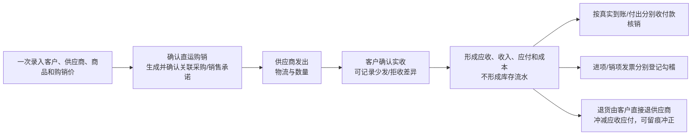

# 供应商直发客户的直运购销规格

> 产品定位：服务小微铜材经销商的低频但真实经营场景；只减少重复开单和虚构仓库动作，不另造库存或财务台账。

## 1. 经营问题

客户向本企业购买铜材，本企业再向一个供应商采购，由供应商直接送到客户地址。货物没有进入本企业仓库，因此不能用“先做假入库、再做假出库”的方式凑流程；但采购承诺、销售承诺、客户实收、应收、应付、收付款、税票、退货和审计仍必须各自成立并能相互追溯。

## 2. 最小操作链

默认只显示一张“直运购销单”。系统内部生成一张销售订单和一张采购订单，供既有的收付款分配、发票勾稽、风险控制、分享和报表继续使用；经营者不需要重复录入三次。

## 3. 状态与过账

| 业务状态 | 可以做什么 | 库存影响 | 往来与会计影响 |
|---|---|---:|---|
| `DRAFT` 暂存 | 修改后确认；未产生下游时作废 | 无 | 无 |
| `CONFIRMED` 待交付 | 登记供应商发出；尚无实收时可作废 | 无 | 只有采购/销售承诺，无应收应付 |
| 供应商发出批次 `DISPATCHED` | 等待客户核对数量 | 无 | 无，不把“供应商说已发”当成客户实收 |
| `PARTIAL_DELIVERED` 部分交付 | 继续补发；对净实收办理退货 | 无 | 仅按客户实际接收数量形成应收应付 |
| `DELIVERED` 已交付 | 收付款、开票、退货 | 无 | 已实收购销金额完整形成往来与凭证 |
| `CANCELLED` 已作废 | 只读追溯 | 无 | 不形成应收应付 |

确认客户实收是唯一的直运交付过账点。供应商发出数量与客户实收数量不一致时必须说明少发、拒收、破损或其他真实原因；未被客户接受的数量不会形成应收应付，后续需要重新登记补发。

## 4. 金额、税票和结算

- 每个商品同时冻结采购价、销售价、数量/计价单位、包装换算和当时的客户/供应商价税规则。毛利按同一笔直运购销的销售金额减采购金额计算，不读取或伪造库存成本。
- 客户实收时按已接受数量分摊整单销售与采购金额；最后一次完整交付吸收分币尾差，保证累计金额与原购销承诺一致。
- 直运销售应收进入关联销售订单，直运采购应付进入关联采购订单。客户收款和供应商付款互不替代，均可分次登记和核销。
- 销项发票关联销售订单，进项发票关联采购订单。开票、收付款、客户实收三者相互独立。
- 对外只读分享只使用销售订单，不输出供应商、采购价、采购金额、毛利或内部备注。

## 5. 退货、差异与恢复

- 只有客户已经实收的净数量可以退货；默认含义是客户直接退给原供应商，不进入本企业仓库。
- 确认退货同时冲减应收、销售收入、应付和采购成本，并保留原退货单、数量、金额、原因、经办人与时间。
- 退货冲减后的应收不得低于已收款与应收调整，冲减后的应付不得低于已付款；超出时必须先冲正或重新分配收付款。
- 已确认退货不能删除或覆盖，只能填写原因后冲正。冲正恢复原购销结算事实和关联订单履约数量。
- 客户退回本企业仓库、换货入仓、供应商拒收或产生额外赔款时，不得继续用本直运退货简化：必须另走真实销售退货入库、采购索赔/调整或费用单据。

## 6. 权限与小微简化

- 老板、管理员和经理可以确认、作废、实收过账、退货与冲正；销售和采购可以共同维护直运草稿及发出信息；财务可查看直运来源并办理既有收付款、发票和凭证。
- 采购价、应付、成本和毛利继续受成本/采购权限控制，销售岗位默认不可见。
- 当前一张直运购销只允许一个供应商。多供应商拆成多张直运单，避免给小微经营者引入复杂的分包履约状态。
- CRM 线索、商机或报价均不是直运开单的前置条件；物流公司和单号允许为空，电话送货也能记录真实经办人与日期。

## 7. 明确不做

- 不生成入库单、出库单、库存批次、库存流水或库存余额。
- 不做供应商门户、物流平台自动回传、承运商计费或多级代发网络。
- 不因直运扩大为通用采购分销平台，也不要求经营者维护第二套往来、资金或发票台账。
