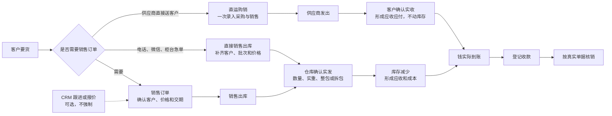
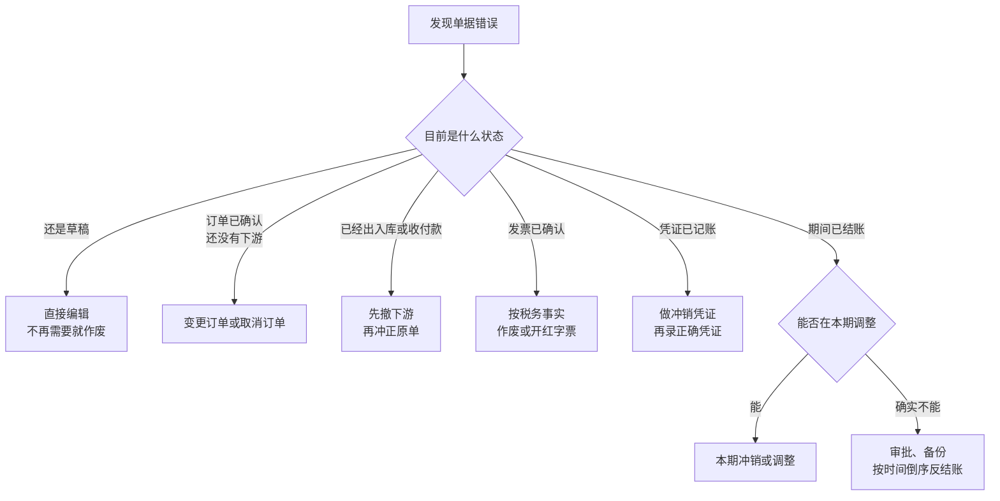

# Copper 老板日常经营与账务安全 SOP（图解版）

> 适用对象：老板、业务、仓库、财务和系统管理员
> 适用范围：首次期初迁移、日常开单、错单冲正、发票勾稽、银行对账、月底关账、备份恢复和反结账
> 核心目标：业务可以快做，错误可以改正，但库存、欠款、资金、税票和总账不能被无痕改写

**阅读方法：先看第 0 节的一页图；遇到具体问题，再展开后面的详细规则。**

## 0. 老板一页图

### 0.1 平时卖货：按真实发生一步一步记

> 看懂这一条就够用：**确认订单不扣库存；确认发货才扣库存并形成应收；钱实际到账以后才登记收款。**

### 0.2 单据错了：先看它走到哪一步

> 错单口诀：**草稿直接改，确认后留痕改；先撤下游，再改上游；能本期调整，就不重开历史。**

### 0.3 月底关账：按这条流水线逐项亮绿灯

| ✅ 日常经营 | ⚠️ 发现错单 | ⛔ 绝对红线 | 🛟 故障恢复 |
| --- | --- | --- | --- |
| 按实际收发、实重和包装记账 | 先查状态和所有下游 | 不直接改库存、欠款或总账余额 | 单笔错单不用恢复备份 |
| 发货、收款、开票分开记录 | 用变更、退货、冲正或冲销 | 不删已确认历史，不录假收付款 | 整站故障先旁路恢复验收 |
| 每天下班前清异常 | 处理后复核库存、往来、资金和凭证 | 不为做平差额虚构费用 | 切换前由老板、财务、管理员确认 |

### 0.4 系统入口速查

| 现在要做什么 | 去哪里 | 点什么 / 看什么 |
| --- | --- | --- |
| 新增复杂商品或批量导入商品 | 商品中心 → 快速建档 / 矩阵建档 / 文件导入 | 先看身份预检 → 再确认单位与包装 → 最后提交；详见[《商品主数据录入与导入 SOP》](PRODUCT_MASTER_ENTRY_AND_IMPORT_SOP.md) |
| 客户正常订货 | 销售订单 | 新建草稿 → 核对 → 确认销售 |
| 供应商直接送货给客户 | 销售管理 → 直运购销 | 一次录入客户、供应商和购销价 → 确认 → 供应商发出 → 客户实收；不要做假入库、假出库 |
| 判断某仓能否按期接单 | 库存可承诺量 | 选择仓库和日期 → 查看现存、占用、销售承诺与预计供应 |
| 看哪些货该补、哪些货压库、哪些销售真正有贡献 | 经营助手 | 先看系统按现存、在途、近 30 天出库和实际出库成本生成的建议；它只提示，不自动下单或记账 |
| 电话、微信、柜台直接发货 | 销售出库 | 直接新建 → 补齐来源 → 确认发货 |
| 送样、内部领用、正常损耗或其他零星出库 | 库存管理 → 送样 / 领用 / 损耗 | 一张单据添加一个或多个商品明细，各明细独立选择批次和来源包装扣取量 → 保存草稿 → 实物交付时确认发放并立即逐项扣库 → 实际领用人签字 → 上传签字单原件归档；错了走冲正，不直接改库存 |
| 给客户看订单或给外部系统查订单 | 采购/销售详情 → 单据分享；经营助手 → 数据接入 | 只发短期只读链接；接口密钥限定往来单位并只显示一次，用完及时撤销 |
| 货物实际入仓 | 进货入库 | 记录批次、实重、包装和成本 → 提交审核 |
| 钱已经实际到账或付出 | 收付款 | 登记真实账户、日期和金额 → 再核销 |
| 特价、超信用、大额付款、资金/库存调整或高风险冲正 | 经营控制 → 例外审批 | 先看触发依据 → 普通经办人提交 → 老板单级批准 → 回原业务执行 |
| 房租、装卸、运输、手续费或其他收支 | 费用与出纳 | 建源单 → 确认往来 → 可选付款申请 → 实际收付 |
| 运费、装卸、检验等计入采购成本 | 采购费用分摊 | 登记采购附加费用 → 冻结进项税处理 → 选择入库明细 → 确认分摊 |
| 企业银行账户之间调款 | 费用与出纳 | 内部账户转账 → 核对转出、转入两条日记账 |
| 发票已取得或已开出 | 进项 / 销项发票 | 登记票面 → 确认 → 做票货款账勾稽 |
| 收到数电票、银行电子回单或电子对账单原件 | 电子凭证与票账税 | 接收原件 → 外部验真/验签 → 上传证据 → 关联业务单据 |
| 月底准备增值税申报资料 | 电子凭证与票账税 | 生成期间底稿 → 清理阻断与票账差异 → 会计复核 → 导出留档 |
| 查看全部现金和银行收支 | 出纳日记账 | 按日期、账户和收支方向核对来源及对账状态 |
| 银行月末核对 | 银行对账 | 导入流水 → 逐笔匹配 → 解释未达 → 确认 |
| 月末锁账 | 期末结账 | 重新检查 → 清完阻断项 → 正式结账 |
| 首次从旧台账切换 | 系统管理 → 期初数据迁移 | 下载模板 → 上传预检 → 应用勾稽 → 负责人确认切换 |
| 查看整站备份 | 存储与容量 | 检查最近成功时间、校验和异地副本 |

### 0.5 数量和重量怎样填写

- 采购、销售、收发货、盘点、退货、直运和包装换算均保留最多六位小数，显示时省略末尾的零；例如 `0.001 t` 是 `1 kg`，不能为缩短页面把真实余量改成零。数量精度与金额精度分开，金额仍按两位小数核算。
- 逐盘、逐卷、逐箱实重按当前商品的主库存单位录入；批量粘贴重量同样允许六位小数。逐包装合计与业务数量按六位精度逐项核对，存在差额先查原件和单位，不能用两位小数掩盖差异。
- 标签识别的重量以 kg 返回，只允许自动换算为明确的 kg/千克/公斤、t/吨或 g/克。其他主库存单位需人工按原件和受控换算填写；识别和人工复核都不能直接代替库存确认。
- 历史草稿打开和保存须保留原有数量；已确认业务继续走原单据变更、撤销或冲正，禁止用修改显示精度的方式重写历史数量。

## 1. 老板先记住这五条

| 看什么 | 只记这一句 |
| --- | --- |
| 📝 单据状态 | **草稿可以改，确认以后不能直接覆盖。** 确认后的错误走变更、退货、冲正或冲销。 |
| ↩️ 改错顺序 | **先撤下游，再改上游。** 最后一笔业务先处理，最后才冲正源头单据。 |
| 🧾 三件事 | **发票、收付款、订单分开记。** 开票不等于收款，收款不等于开票。 |
| 🔒 结账历史 | **结账后不改历史。** 优先在当前期间调整，必要时才按时间倒序反结账。 |
| 💾 备份恢复 | **恢复备份不是改单工具。** 单笔错误用冲正，整站故障才考虑恢复。 |

一句话判断：**能在草稿改，就不要确认后改；能用冲正改，就不要反结账；能在当前期间调整，就不要重开历史。**

## 1.1 首次启用：期初数据怎么迁

期初迁移只用于尚未发生正式经营事实的空白账套。它不是日常补数据工具，也不能用来覆盖已经形成的库存、应收应付、资金、发票或总账。

1. 老板、财务和系统管理员先确定正式切换日，完成旧系统全量备份，并在约定时点冻结旧系统新增、修改和删除。冻结后再导出的清单才是本次期初依据。
2. 先在 Copper 建好会计期间、会计科目、商品分类与系列、规格字段和受控单位。不要为了赶导入把品类、单位或科目写进备注；这些口径以后要支撑采购、库存、销售和会计。
3. 进入“系统管理 → 期初数据迁移”下载标准模板。只填写七张业务表：往来单位、仓库、商品、库存期初、往来期初、资金期初、总账期初。来源键使用旧系统稳定编号，不用名称做跨表关联。
4. 库存逐商品、仓库和批次填写数量及单位成本；应收、应付、预收、预付分别填写；现金和银行余额分开填写；总账期初按实际科目借贷录入。库存、往来、资金与总账必须逐项勾稽，不能用一条“其他”差额强行配平。
5. 财务上传工作簿执行预检。预检只保存逐行结果，不形成经营事实。任何错误都回原工作簿修正后重新上传，不在页面里临时改数，也不直接改数据库。
6. 预检通过后，老板或系统管理员核对旧系统冻结清单、文件 SHA-256、各域行数和金额，再“应用期初”。应用会形成库存批次、往来来源单、预收预付流水、资金事实和草稿期初凭证，但此时尚未确认切换。
7. 应用后逐项核对库存数量与成本、客户应收和预收、供应商应付和预付、现金银行余额、期初凭证借贷及试算平衡。没有任何后续出入库、收付款和其他记账事实时，发现错误可以整批撤销；一旦已有下游，系统会拒绝无痕回退。
8. 老板在企业会计复核后填写切换依据并“确认切换”。系统再次勾稽、审核并记账期初凭证。此后旧系统只读留档，Copper 成为新业务记账起点；期初错误必须通过调整、冲正或越期调整处理，不能重新覆盖原批次。

岗位分工：财务默认可以下载模板、上传和修正预检；老板或系统管理员负责应用、切换前整批撤销和最终确认切换。小微商户只有一人时，也要分别保存应用前、切换前和切换后的检查结果，隔时复核，不把“一人经营”理解成可以不留依据。

系统一致性检查只证明 Copper 内部的库存、往来、资金与总账能够勾稽，不替代企业会计对法定期初余额、会计科目、纳税人身份和税务资料的专业复核。

## 1.2 轻量经营助手怎么用

这些入口都是可选助手，不改变采购、入库、销售、出库、收付款和对账的正常顺序，也不能成为员工多填一套台账的理由。

1. **补货和库龄只看建议，不自动下单。** 系统用现存、草稿占用、已确认在途采购、近 30 天已出库和供应交期计算，并在页面说明公式。老板结合眼前订单、供应商假期和行情决定是否采购；决定采购后仍从采购订单正常开草稿。
2. **销售贡献只认已出库事实。** 未出库订单不算收入，成本取出库时冻结的实际批次成本。房租、运输、装卸等费用先在“费用与出纳”建立真实源单，需要分析某一单赚多少时再分配；分配不是付款、核销或会计凭证，撤销分配也不改原费用。
3. **采购报价比较不静默改单。** 电话、微信收到多家报价时，可在采购草稿旁记录商品价、运费、交期和结算条件。选用只保存采购决策，确认订货前仍须核对草稿中的供应商、商品、价税和数量，避免单位换算或含税口径被自动改错。
4. **扫码只是帮忙找商品和批次。** 出库扫描已配置的包装条码后，系统优先带出可用批次；仓库仍要核对实物、规格、仓库、批次和数量后再确认，扫描本身不扣库存。
5. **质保书按需维护。** 只有客户、合同或批次管理确实需要时才登记证号、厂家批号、炉号/卷号并复核；它不是所有入库的必填项。已复核错证必须作废并新建，不能覆盖历史。
6. **送样、领用和损耗按实物发放扣库存，签字随后归档。** 从独立单据入口可在一张单据中增加多个商品明细；每项独立选择有自由库存的批次，逐件实重货再从多盘、多卷或多箱分别填写实际扣取量，该商品数量由本行包装扣取量自动合计，禁止另填一套总数。实际领用人、经办人/发放人和系统制单人分别记录，不能用一个姓名混代三个角色。保存草稿后，实物实际交给领用人时点击“确认发放并扣库存”，系统立即逐项扣库存、结转成本并进入“已发放待签字”；实际领用人可随后签字，上传原件并归档所选附件及其 SHA-256，归档不得再次扣库存。待签字期间发现错误要按原单填写原因冲正，月结前必须补齐签字凭证。它不是销售出库，不形成销售履约、应收或客户结算。
7. **签收不等于收款。** 已出库后可登记发出、签收和异常；客户签收只说明交付状态，不自动增加已收金额，也不自动核销应收。钱到账后仍按真实账户登记收款。
8. **分享和接口只给最小数据。** 对外链接设置有效期，可随时撤销，不包含内部备注、库存成本和欠款；接口密钥只允许指定往来单位读取自己的订单，明文只显示一次。怀疑泄露时立即撤销，不在聊天记录中长期保存。
9. **文件导入必须先预检。** 银行流水、电子凭证、发票和期初资料继续使用各自现有导入入口；预检报错回源文件修正。系统未配置真实第三方凭据时，不把文件导入描述成银行、税务或物流直连。

<strong>展开：日常开单与错单冲正详细规则</strong>

> 适合业务、仓库和财务在开单或改错时查阅。

## 2. 谁负责什么

| 角色 | 默认能做 | 默认不能做 |
| --- | --- | --- |
| 老板 | 查看经营与成本，维护例外阈值，对特价、超信用、大额付款、资金/库存调整和高风险冲正作一次性例外授权，处理重大业务，批准并执行反结账，维护企业银行账户 | 不把例外授权交给普通经办人，不要求员工直接改余额、删历史或改数据库 |
| 财务 | 应收应付、费用与其他收支、付款申请、出纳日记账、库存成本、发票、凭证、银行对账和正式结账 | 默认不能反结账；须由老板或系统管理员执行 |
| 仓库 | 查看全部待收待发单据，处理入库、出库、调拨和盘点 | 不看采购价、库存成本、销售毛利；不改凭证、发票、银行账户和期间 |
| 销售 | 本人客户跟进、销售订单、出库与本人业务的应收回款 | 不自行调整授信/最低毛利策略或授权风险例外；不看采购价、库存成本和毛利；不改凭证、发票、银行账户和期间 |
| 采购 | 本人采购、采购价、采购入库和采购退货 | 不看库存计价金额和销售毛利；不改凭证、发票、银行账户和期间 |
| 系统管理员 | 账号权限、整站备份、旁路恢复和运行安全 | 不替业务人员判断价格、税率、库存或会计科目 |

小微企业允许一人兼多个角色，但结账、反结账和正式恢复至少要留下“经办人、复核人、原因和时间”。只有一个人时，应在操作前后分别保存检查结果，隔时复核；有外部会计的，应让会计复核税务和会计影响。

老板或管理员应定期进入“系统管理 → 角色权限 → 默认岗位验收”。只有老板、财务、仓库、销售、采购五个岗位全部显示“通过”，才说明默认授权可用；只看到权限码已经建立不算验收通过。多人兼岗时权限取并集，因此不能用“主要角色权限较少”来抵消另一个角色已经授予的敏感权限。

## 3. 日常开单 SOP

### 3.1 每天开工前

- 确认系统日期和业务日期正确，不要为了赶上月业绩把今天的业务倒填到上月。
- 查看“存储与容量”，确认最近成功整站备份存在、磁盘没有进入严重或危险状态。
- 查看昨日未完成事项：入库待审核、出库草稿、未定价出库、未核销收付款、业务过账异常和会计凭证草稿。
- 新商品先按[《商品主数据录入与导入 SOP》](PRODUCT_MASTER_ENTRY_AND_IMPORT_SOP.md)完成身份、单位和包装预检；不要为赶单临时复制近似商品或把规格写进备注。
- 新月份开始前，确认会计年度和期间已经初始化；新月正常业务不应因为上月还在核对而停摆。

### 3.2 销售开单

1. 从“销售订单”直接新建；电话、微信、柜台、补录业务不要求先建立 CRM 线索、商机或报价。
2. 选择正确客户，核对商品、规格、仓库、数量、计价单位、包装、含税口径、价格、交货日期和收款条件。
3. 铜材按实际包装和实重处理：原包进、原包出时录入原包实重；允许拆包的接头等商品，按受控包装换算和实际拆包数量记录。
4. 先保存草稿，向客户核对后再“确认销售”。确认销售只形成待发承诺，不立即扣库存，也不立即形成应收。
5. 实际发货时建立“销售出库”，由仓库核对实际批次、数量和包装后“确认发货”。确认发货才扣减库存，并按实际业务形成应收和成本。
6. 没有销售订单也可以直接出库，但必须选择客户、实际批次、业务来源和价格状态。不能因为业务来得快就省略客户、库存批次和来源说明。
7. 银行、现金、预收款和承兑分别登记。到账以后再做回款及核销；一笔钱可以分配给多张单，一张单也可以分多次收款。

### 3.2.1 客户信用、逾期和最低毛利控制

1. 老板或系统管理员在“往来单位详情 → 销售风控策略”按客户决定是否启用。策略至少选择一项：信用额度、逾期欠款或最低毛利；每次调整都必须填写经营依据并生成新版本。普通销售不能在编辑客户资料时绕过策略直接改授信额度。
2. 信用敞口不是只看已出库应收。系统统一计算“已形成未结应收 + 已确认未发货销售承诺 + 本次新单 - 客户预收余额”。持有中的承兑在收票时已经核销对应应收，只单列展示票据资产，不再次抵减敞口，避免重复计算。
3. 确认销售、确认订单变更和确认发货都会重新计算，不使用上一次打开页面时的旧数字。同一客户并发确认时必须先锁定客户再复算，防止两张订单各自看似未超额、合计却越过授信。
4. 最低毛利使用未税销售额与当前可追溯库存成本估算。订单确认使用当前库存加权成本，发货使用实际出库批次成本；它只决定是否放行，不替代出库后的正式库存成本、会计凭证或利润表。没有可靠成本、直接出库尚未定价时，不能假装毛利已经通过。
5. 风险通过后正常确认。出现超信用、超过允许逾期天数、低于最低毛利或毛利无法可靠计算时，普通销售必须返回调整价格、收款条件、预收款或欠款处理；不能用备注、口头同意或付款截图绕过。
6. 确需继续时，只允许老板或系统管理员在当前单据填写不少于 8 个字的明确原因并作一次性授权。授权只对“当前单据 + 当前版本 + 当前动作”有效，不修改客户长期策略，不自动放行后续变更或下一次发货。
7. 每次通过或例外授权都保存当时的应收、待发承诺、本单金额、预收、授信、逾期、预计成本、毛利、策略版本、原因、操作人和时间。普通销售仍按字段权限看不到成本和毛利金额，但风险结论和处理方法必须可见。
8. 信用和毛利控制不允许直接修改已确认订单、库存、应收或会计结果。后续真实退货、收款、承兑、冲正和订单取消按各自单据处理，系统据此在下一次校验中释放或重算敞口。

### 3.2.2 库存可承诺量（ATP）与交期承诺

1. 销售订单草稿可以先保存不完整信息，但“确认销售”前必须指定唯一履约仓库和计划交付日期。确认不是简单看今天的库存，而是检查从今天到承诺日期及其后所有已有承诺日期，防止一张提前交货的新单挤占已经答应给其他客户的货。
2. “库存可承诺量”统一按时间计算：当前实际结存，减去未发货销售承诺和无订单出库草稿占用，再加上预计日期之前已确认采购的未到数量、已经发出的调拨在途数量。销售订单关联的出库草稿已经包含在该订单承诺中，不重复扣减。
3. 采购订单只有在已确认订货、填写预计入库仓库和预计到货日期后，才作为预计供应；调拨只有确认发出并填写预计到达日期后，才作为调入仓的在途供应。预计供应只帮助判断交期，不增加实际库存，也不能替代入库或调拨收货。
4. 系统显示“可承诺”只代表当前已登记事实支持该交期，不是供应商必然准时到货的保证。老板或业务仍应结合供应商可靠性和运输风险预留缓冲；交期发生变化时应及时做采购、调拨或销售订单变更。
5. 确认销售和确认订单变更时，系统会在数据库内锁定“商品 + 履约仓库”并重新计算，避免两个人同时把同一批可用量重复答应给不同客户。通过后保留当时的计算版本、现存、占用、供应、短缺日期、操作人和时间，作为交期承诺审计依据。
6. 旧订单如果不能从历史单据唯一判断履约仓库，会列为“未分配销售需求”并阻止继续承诺相关商品，不能静默分摊到任意仓库。应先核对真实履约仓库和交期，再通过正式订单变更补齐。
7. 销售出库必须使用订单的履约仓库；采购入库必须使用采购订单的预计入库仓库。需要换仓或改交期时先做有原因、有版本、有审计的订单变更，禁止在出入库环节临时换仓掩盖承诺偏差。
8. 取消已确认销售订单会释放尚未履行的承诺并留下释放记录；已经存在出库草稿、实际发货、收款或其他下游事实时，必须先按时间倒序撤销或冲正下游，不能直接取消订单制造账实不符。

### 3.3 采购开单

1. 从“采购订单”建立草稿，核对供应商、商品、规格、数量、包装、价格、税率口径、交期和付款条件。
2. 供应商确认后再“确认订货”。草稿不形成正式应付，也不能当成已到货。
3. 实际到货时建立“进货入库”，仓库记录实际批次、实收数量、实重、包装和成本资料，提交审核。
4. 审核通过后才增加库存并形成应付。订单数量和实收数量不一致时，以实际入库为准，订单保留未到数量或按正式变更处理。
5. 付款和入库分开登记。供应商说“已发货”不等于已经入库，付款申请也不等于已经核销应付。

### 3.3.1 供应商直接送客户的直运购销

1. 只有货物确定不进入本企业仓库、由一个供应商直接送到客户地址时才使用“销售管理 → 直运购销”。普通先入仓后销售仍走采购订单、进货入库、销售订单和销售出库。
2. 一次选择客户、客户收货地址、供应商和商品，同时填写采购价与销售价。保存后系统关联生成采购、销售承诺，经营者不需要重复开两张订单；确认前仍要核对单位、价税口径、数量、交期和毛利。
3. 供应商口头说“已发货”时只登记发出日期、数量和可选物流信息，不形成应收应付。客户实际收到后再点“确认客户实收”；少发、拒收或破损必须按实收数量填写，并说明差异。
4. 客户确认实收后，系统按实收数量形成销售应收、收入、采购应付和成本，但始终不增加或减少本企业库存。禁止为了让普通入出库流程看起来完整而建立假仓库、假入库或假出库。
5. 客户到账后从直运详情进入“登记客户收款”，本企业实际付给供应商后再“登记供应商付款”。收款和付款互不等待，也不能互相抵消；进项、销项发票仍分别关联采购、销售订单登记。
6. 客户直接退给供应商时使用“登记直运退货”，只可退客户当前净实收数量，并同时冲减应收应付。已经收付的金额会限制可退金额；需要先处理多收、多付或重新分配核销，不能让退货后的欠款小于已经发生的资金。
7. 直运退货录错时填写原因冲正，禁止删除。若货物实际退回本企业仓库、供应商拒收、发生换货入仓或额外赔款，应改走真实销售退货入库、采购调整或费用单据，不能继续套用“不进库存”的简化路径。

### 3.3.2 价税口径和历史快照

1. 新建采购或销售订单时，系统只把往来单位主档中的“含税/未税、默认税率、发票类型”作为本次开单默认值；确认前必须按真实合同核对。以后修改客户或供应商主档，不得回写已经建立的订单。
2. 报价转销售订单时必须完整沿用报价修订版的含税口径、各行税率和价税规则快照，不能先换算成另一种价格再转单。直接开单、编辑和订单变更也必须保留各自已经冻结的价税口径。
3. 入库、出库从来源订单承接价税快照；采购退货、销售退货按原入库或出库各行的未税额、税额和价税合计比例冲减，最后一次全量退完时由最后一行吸收累计分币尾差。禁止用退货当天的主档税率重算历史。
4. 系统按单据行使用十进制定点金额和四舍五入到分，保证每行及整单满足“未税金额 + 税额 = 价税合计”；折扣、调整及不足一分的分摊尾差必须保留在单据快照中，不得手工改总额把差额藏掉。
5. 历史税率、价格口径或规则发生变化时，只能影响新单。已经确认、出入库、退货、开票或制证的历史业务必须走变更、退货、红冲、冲正或调整单，禁止覆盖原快照。

### 3.3.3 应收应付与账龄怎么看

1. “应收账款”“应付账款”页顶部金额是服务器按当前全部筛选结果汇总，不是把当前页明细相加。翻页和每页条数只改变下方明细，不应改变同一筛选条件下的汇总与账龄；往来单位详情中的欠款也使用同一汇总口径。
2. 每次查看先确认页面显示的“数据截止时间”和“账龄基准日”。当前报表反映该数据库快照时点的余额，不等同于任意历史日期余额；需要月末历史证明时，应使用已结账期间、总账、明细账和留档证据，不得把今天的订单余额倒推成过去余额。
3. 原始应收应付、调整/退货冲减、净额、已收付和待收付必须分开核对。采购退货中，只有“应付冲减金额”减少应付；已经多付而形成的“供应商预付款”继续作为独立余额，不能再次从应付中重复扣减。
4. 业务单据创建或草稿改动时固化当时的往来单位结算天数和到期日；以后修改客户、供应商主档账期，不得回写或重新计算已经形成的历史应收应付账龄。账龄分为未到期、今日到期、逾期 1—30 天、31—60 天、61—90 天和 91 天以上。改变客户、供应商、来源、到期范围或到期日期后，单据数、金额和账龄必须一起刷新并保持勾稽。
5. 页面因业务单据数据范围受限而拒绝生成汇总时，应由管理员授予与岗位相符的完整财务查询范围；禁止导出局部数据后手工冒充企业全量余额。

### 3.3.3 采购运输、装卸、检验等附加费用怎么进成本

1. 只有使本批采购货物达到当前场所和状态、且能可靠归属的运输、装卸、保险、入库前检验整理等费用，才进入“费用与出纳 → 采购附加费用”。仓库日常租金、销售配送费、异常损耗、罚款及不能归属到本批采购的支出，不得为了提高库存成本而强行分摊。
2. 建费用源单时必须选真实费用供应商、业务日期、账单或合同编号、含税口径、票面税率和 `5401 主营业务成本`。同时冻结“进项税处理”：一般纳税人且用途允许抵扣时选“可抵扣，不计成本”；小规模纳税人或明确不抵扣时选“不抵扣，计入成本”。这个选择会决定后续分摊未税净额还是价税合计，确认前必须由企业会计复核。
3. 费用源单确认只形成其他应付和草稿凭证，不自动付款、不自动取得发票，也不改变库存。实际付款、进项发票和采购费用分摊仍分别登记并相互勾稽。
4. 打开“采购费用分摊”，选择已经确认的费用源单和真实采购入库明细。铜材数量口径一致时优先按入库数量；承运商按公斤计费或混合不同库存单位时按计费重量；保险费等以货值为基础时按未税金额；只有合同明确指定且附计算表时才手工分摊。手工金额合计必须等于本单“计入成本金额”。
5. 草稿只做预览，不影响库存。确认时，系统按原入库数量计算单位附加费：仍在库部分计入当前批次成本；确认前已经销售、退货或盘亏的部分保留在当期主营成本，不倒改历史销售成本。已完成调拨的后继批次继承同一费用组件；存在调拨在途时必须先收货或冲正再确认。
6. 费用分摊后发生采购退货，退回库存按“原采购成本 + 对应单位附加费”减少；附加费部分转回当期主营成本，因为运输商的应付和发票并不会随原材料退给供货商而自动消失。是否另向运输商索赔或取得红字发票，必须另按真实业务处理。
7. 录错后按时间倒序处理：先冲正更晚的采购退货、调拨或成本调整，再冲正采购费用分摊，最后才能冲正费用源单。分摊冲正只退出冲正时仍在库的费用组件，已经耗用的历史成本不被无痕改写；跨期或已结账时按第 8 节处理。
8. 进项发票勾稽必须与源单冻结的税务处理一致。“税额计入成本”的来源不得再把同一税额确认为可抵扣进项税；已确认不抵扣用途后也不得直接解除来源勾稽。纳税人身份、抵扣资格或用途变化时，应由企业会计按红冲、进项转出或会计冲销路径处理，禁止直接改源单选项。

本节以财政部[《企业会计准则第1号——存货》](https://kjs.mof.gov.cn/zt/kjzzss/kuaijizhunzeshishi/200806/t20080618_46216.htm)关于采购成本包含可归属运输、装卸、保险等费用，以及财政部[《小企业会计准则》](https://kjs.mof.gov.cn/zhengcefabu/201111/P020111118325852319878.pdf)关于外购存货成本和不可抵扣税费的口径为设计依据。企业实际执行的会计制度、纳税人身份和当期抵扣政策可能不同，正式记账与申报前仍须由企业会计或税务专业人员复核。

### 3.4 收付款与核销

1. 钱实际到账或付出后，先选择真实往来单位、日期、结算方式、银行账户和本次总金额；银行流水、现金收付与预收预付必须按真实性质分开。
2. 普通收付款可以在登记时分配给多张销售/出库或采购/入库单据，也允许只分配一部分。系统分别显示“本次金额、已分配、未分配”；普通资金的未分配余额仍属于该笔收付款，不会自动变成预收款或预付款。
3. 一张应收或应付允许由多笔资金分次核销。分配前核对往来单位和单据待收待付金额，不得跨客户、跨供应商或超额核销。
4. 实际资金没有变化、只是原核销对象选错时，使用收付款详情中的“调整核销分配”：先释放错误分配，再使用未分配余额或释放金额重新分配，并填写具体原因。该动作不重复收付款；已分配总额变化时，系统形成未分配资金与应收应付之间的重分类过账和会计凭证，等额换单只改核销对象、不重复制证。原分配、释放和重分配记录永久保留。
5. 已参与发票资金勾稽的收付款，必须先解除相关勾稽再调整分配；已参加银行对账的整笔资金不能直接冲正，应先按第 6 节重新打开对账并撤销匹配。
6. 只有真实整笔资金记录本身错误时才执行“冲正”。冲正会撤销全部仍有效的核销分配并形成反向业务过账；禁止只改表头金额、删除分配记录或用一笔假收付款抵消错误。

### 3.4.1 奖励、返利、期初和往来余额差错

1. “往来账户”直接增加/扣减余额的旧入口已经退出。客户奖励、供应商返利、首次上线期初及确需修复的余额差错，统一进入“余额调整单”；真实到账、付款、退款、退货和核销继续使用各自原业务单据，不能改走余额调整。
2. 先保存草稿并附合同、返利对账单、原错误单号、迁移批次或其他可复核依据。草稿不影响余额；拥有 `partner.fund.adjust.approve` 权限的负责人确认后，才更新余额、形成业务过账和草稿会计凭证。编制、确认、冲正均保留操作人、时间和原因。
3. 期初余额只允许用于尚无余额和流水的客户预收或供应商预付账户，且只能增加。录错必须冲正原期初后重做，禁止重复补录或把日常业务伪装成期初。
4. 客户奖励只增加客户奖励金，供应商返利只增加供应商返利金；后续用余额核销应收应付时不形成现金或银行流水。奖励和返利必须标记“待会计/税务复核”或“发票已单独处理”，余额调整单本身不等于销售折让、红字发票、进项转出或纳税申报处理。
5. 差错调整可以增减四类往来余额，但必须写明原事实、错误原因、金额计算和复核依据。原业务单可冲正时应优先冲正原单，禁止用差错调整掩盖真实收付款、退货、坏账、折让或发票错误。
6. 已确认调整录错时执行“冲正”，系统追加反向余额流水、反向业务过账和冲销凭证，不覆盖原单。余额已经被订单占用或后续核销使用、冲正会造成负余额时，必须先处理下游业务；不得临时增加一笔余额绕过阻断。
7. 自动凭证始终先保持草稿。企业会计应结合执行的会计制度、业务证据、所属期间和税票事实复核科目；跨期重大差错、销售折让、返利发票或已申报税额变化必须按第 12 节请专业人员判断。

### 3.4.2 对公费用、其他收支、付款申请和内部转账

1. 房租、装卸费、运输费、银行手续费等对公费用，以及真实的其他收入、其他支出、其他应收和其他应付，统一从“费用与出纳”建立业务源单。必须选择真实往来单位、业务日期、到期日、依据编号、费用或收入科目、含税口径和税率；员工报销不在此流程中，后续按员工报销专门流程办理。
2. 草稿只用于录入和复核。确认源单后才形成其他应收或其他应付及草稿会计凭证；源单先按价税合计记录费用或收入，取得或开具发票后，再由发票勾稽凭证把税额从对应费用或收入科目重分类，禁止源单和发票各记一次税额。
3. 付款申请是可选的授权步骤，只适用于费用或其他应付。批准申请不代表已经付款，不产生银行流水、出纳日记账或资金凭证；只有网银、现金等资金真实付出后，才在源单详情登记实际付款。部分申请、部分付款和一单多次付款均按剩余金额控制，不能超额。
4. 其他收入或其他应收在资金真实到账后登记收款。实际收付必须选择现金或具体企业银行账户、真实日期、金额、用途和现金流量分类；系统生成资金事项、出纳日记账及草稿凭证，并更新源单已收付和未结金额。
5. 企业自有银行账户之间调款使用“内部账户转账”，一次形成同额的转出和转入两条出纳日记账及一张借贷凭证。内部转账不属于经营、投资或筹资现金流入流出，不能虚增现金流量表收支，也不能借此改变往来余额。
6. “出纳日记账”统一查看销售回款、供应商付款、客户退款、承兑资金、费用及其他收支和内部转账。旧“资金流水”入口仅兼容跳转；以后以统一日记账的来源单号、账户、方向、金额、现金流量分类和银行对账状态为准。
7. 源单或资金录错时，先检查发票勾稽、付款申请、银行对账和会计凭证。已进入银行对账的资金必须先撤销匹配或系统未达项；再冲正资金，最后才冲正已无有效收付款的源单。禁止删除日记账、直接改已收付金额或用反向假费用抵消。
8. 费用或收入发票可分别勾稽业务事实、其他应收应付、资金和会计凭证。发票在源单之后取得不改变原源单价税快照；后补或解除费用税票勾稽时，系统通过调整或冲销凭证保留轨迹。跨期、已抵扣、已申报或科目判断存在争议时，由企业会计或税务专业人员复核。

本节以现行[《中华人民共和国会计法（2024年）》](https://kjs.mof.gov.cn/zhengcefabu/202408/t20240812_3941615.htm)关于按实际经济业务取得原始凭证、编制记账凭证并定期核对款项的要求为底线；进项税额是否允许抵扣还应结合[财政部、税务总局公告2026年第13号](https://fgk.chinatax.gov.cn/zcfgk/c102416/c5247494/content.html)及企业纳税人身份、扣税凭证和实际用途判断。系统登记税率或生成待认证税额不等于自动取得法定抵扣资格。

### 3.5 高风险例外怎么申请和执行

1. 例外审批只覆盖六类少量高风险动作：特价、超信用、大额付款、往来资金调整、库存盘亏/大额成本调整和达到阈值的高风险冲正。普通报价、正常信用内销售、阈值以下付款、正常收发货和日常查询不增加审批步骤，也不得为了“流程统一”先走审批。
2. 经办人在原业务页面看到风险阻断后，先修正能修正的问题。确有真实经营理由无法按普通规则执行时，填写至少包括“为什么必须现在做、原始依据是什么、由谁承担复核责任”的申请原因；系统只冻结申请时的单据版本、金额、对象、动作、策略版本和 SHA-256 快照，不产生库存、应收应付、资金、发票或凭证事实。
3. 默认由老板或获授 `risk.exception.approve` 的负责人单级批准，不建设会签、抄送、条件分支或多层 BPM。负责人必须核对原业务依据、金额、往来单位、库存或资金影响和后续恢复路径，可批准、退回或转交给另一名有审批权限的负责人；申请人发现信息错误时可主动撤回。
4. **批准不等于执行。** 批准后，经办人仍须回到原销售、付款、库存调整、余额调整或冲正页面执行一次。系统会重新计算当前风险并逐字段核对冻结快照；单据版本、金额、风险或关键字段变化，审批立即不可用，必须重新申请。批准只能成功消费一次，重复点击不会重复形成业务事实。
5. 老板本人在原业务页面处理时，可填写具体原因后一步授权并执行；如果同一快照已经有待办，系统复用该待办并结清，不额外遗留悬空申请。该便捷路径仍保存策略版本、快照摘要、原因、操作者、批准时间、执行时间和结果单号。
6. 大额供应商付款先提交“付款意向”，批准前绝不生成供应商付款、银行日记账、核销关系或会计凭证；批准后仍要重新校验付款权限、供应商状态、金额、分配和账户，再由经办人显式执行。网银未实际付出时不得借审批结果登记假付款。
7. 例外批准默认 72 小时有效，老板可按企业风险承受能力调整大额付款、库存调整、高风险冲正阈值和有效期；每次调整必须填写原因并生成新版本，历史申请继续引用原策略版本，不追改历史。过期、退回或撤回后不能执行。
8. 每天下班前进入“经营控制 → 例外审批”，清理待审批、已批准待执行和 24 小时内到期事项。月底关账前，所有已批准未执行事项必须明确执行或撤回；不得把审批当成已发生业务，也不得用审批绕过发票、银行对账、期间锁定和冲正顺序。

### 3.6 每天下班前五分钟

- 草稿：确认是明天继续，还是明确作废；不要长期堆积无法解释的草稿。
- 库存：查看负库存、批次异常、未完成调拨和待审核盘点。
- 往来：查看当天新增应收应付、预收预付及未核销资金。
- 资金：统一出纳日记账中的银行收付款、费用收支和内部转账，与网银实际流水是否都有来源单号且方向、金额一致。
- 凭证：查看业务过账和自动制证异常；不要等到月底才处理整月错误。
- 例外：查看待审批和已批准待执行事项；不再需要的由申请人撤回，不让批准长期悬空。

### 3.7 四个可选小助手怎么用

1. **采购跟催**：普通采购订单确认后，可在订单详情登记“供应商已发、预计到货、延误、异常、异常已解决”。分批发货只填本次实际发出数量。它只帮助业务和仓库安排接货，供应商说已发不等于已经入库、形成库存、应付或付款；实际收货仍必须走进货入库。直运购销继续在直运详情登记发出和客户实收，不重复登记采购跟催。
2. **客户外部确认**：报价详情、应收账款按客户筛选后的对账页、销售订单交付摘要都可生成短期确认链接。发送前先核对往来单位、截止日、单据和金额；链接只发给对应客户。客户“内容无误”只说明看过该次冻结内容，不代表钱已到账、完成核销、已经开票、已经签收或取得可靠电子签名。客户提出差异时，回到原单据查明事实并按正规变更、冲正或补录处理，禁止直接改确认结果。
3. **7/30 天现金窗口**：经营助手同时显示“不等未来回款”的保守余额和“按账期预计回款”的计划余额。老板安排付款时优先看保守口径，再逐笔点开来源核对；应收只是预计流入，不能因为客户说要付就当成银行现金。窗口只读，不会替老板创建付款计划或自动延后应付。
4. **单据识别候选**：只上传供应商报价单、磅单和签收单原件。可复制文字的 PDF/文本会生成字段候选；扫描图片没有文字时，可粘贴设备识别文字或人工核对。点“确认候选”仍只是确认抄录结果，不会自动创建采购报价、入库、库存、交付、应收应付或收付款；需要入账时仍从正式业务入口办理。
5. 以上四项均为可选助手。忙时可以先完成真实接单、收发货和收付款，再按事实补充协同记录；不得为了让助手显示完整而伪造日期、数量、金额或确认人。

### 3.8 手机快速办事怎么用

1. 电脑版右上角进入“手机办事”，也可以在手机浏览器直接打开 `/mobile` 并添加到主屏幕。它使用同一个账号和权限，不需要选择“老板版、销售版、仓库版”，也不能靠切换角色扩大权限。
2. “查货”显示当前服务器库存批次。要区分实存、已预留、自由可用和在途；看到旧页面或断网提示时，不得口头承诺仍以页面旧数为准，应恢复连接并刷新。
3. “报价 / 下单”只保存草稿。客户现场确认购买后，仍要进入销售订单详情核对地址、税价、交付、仓库、收款条件和库存可承诺量，再按原流程确认。报价草稿不占库存，销售订单草稿也不产生应收。
4. “收款”只登记已经真实到账的钱。银行收款必须选择实际入账账户；核销可一次分配多张应收，也可暂不分配。断网或没有看到成功提示时，先查回款列表和银行流水，确认没有成功记录后再重试，禁止重复记账。
5. “扫码盘点”先选实际所在仓库，扫描只用于找到批次，实盘数量必须由盘点人填写。有差异时写明破损、少发、计量差异等具体原因。手机保存后只是草稿，复核人必须在盘点详情确认；确认前库存不会变化。
6. “拍照归单”必须先选原采购、入库、销售、出库、回款或盘点单，再拍磅单、签收单或回单。照片上传成功只增加附件和审计信息，不代表已收货、已签收、已收款、已核销或已记账。
7. 手机端只缓存静态页面外壳，不缓存业务接口结果。系统不支持离线收款、离线确认盘点和网络恢复后自动过账；任何现场操作都以服务器明确成功提示和原业务单查询结果为准。

## 4. 错单冲正 SOP

### 4.1 先按状态判断

| 发现错误时的状态 | 正确做法 | 禁止做法 |
| --- | --- | --- |
| 草稿 | 编辑草稿；不再需要就填写原因后作废 | 删除数据库记录或把草稿假装成正式单 |
| 订单已确认、尚无出入库和收付款 | 继续交易用“变更订单”；不再交易用“取消订单” | 直接覆盖原版本和原金额 |
| 已入库或已出库 | 满足条件时冲正；真实退货走采购退货或销售退货 | 只改库存余额、不留反向流水 |
| 已收款或已付款 | 先确认未被对账、预收占用、票据或后续业务使用，再冲正并重新登记 | 改订单已收/已付金额或录一笔假退款 |
| 发票草稿 | 编辑或作废草稿 | 把草稿当成税务平台已开票事实 |
| 发票已确认 | 按真实税务处理作废或开红字票，并重新勾稽 | 改原蓝票号码、金额、税率或覆盖原票 |
| 凭证已记账 | 生成冲销凭证，审核、记账后再录正确凭证 | 修改已记账分录或直接改总账余额 |
| 银行对账已确认 | 开放期间内先重新打开对账单，再撤销匹配、差异或未达项 | 为了把差额变成零而虚构费用或收款 |
| 会计期间已结账 | 先判断能否在当前开放期间调整；必须改原期才规范反结账 | 直接改历史数据、改结账状态或恢复旧备份覆盖现账 |

### 4.2 错误入库

可直接冲正入库的前提是：尚未付款、没有已确认采购退货、相关批次没有出库/调拨/盘点/成本调整等后续流水，也没有被出库草稿占用。

处理顺序：

1. 查“入库详情”和库存流水，核对原始入库数量、当前账面结存、自由可用量，以及关联的送样、领用、损耗和其他下游业务；不得把原始入库数量当作当前库存。
2. 有出库草稿占用时，先作废或更换该草稿的批次。
3. 有付款时，先确认银行对账状态和资金后续用途，再冲正付款。
4. 有采购退货、成本调整、盘点、调拨或出库时，从最新的一笔开始逐项冲正或完成规范退货。
5. 下游清理完成后，填写具体原因冲正入库。
6. 重做正确入库，并复核库存数量、库存成本、应付和相关凭证。

如果货物确实已经进仓，只是供应商、发票或价格资料有误，不应为了改资料把真实入库冲掉。应根据错误性质使用订单变更、采购退货、成本调整或发票红冲。

### 4.3 错误出库

- 货物实际没有发出，且没有退货、回款超额或后续成本变化时，可以“反向出库”，恢复原批次库存并冲回应收。
- 货物已经发出又实际退回，应办理“销售退货”，不能用反向出库冒充退货。
- 无订单直接出库已经收到客户款时，优先办理销售退货和退款/预收处理；系统会拒绝把有真实资金的出库直接抹掉。
- 已有回款、承兑或核销时，先处理资金和核销关系，再处理出库；不得让应收小于已核销金额。

完成后同时核对：原批次库存是否恢复、应收是否冲回、客户预收是否正确、销售订单待发数量是否恢复、成本和会计凭证是否有反向记录。

### 4.4 错误收付款

1. 打开收款或付款详情，先判断是“资金事实错误”还是“核销对象错误”，并检查它是否已经参加银行对账、发票资金勾稽、预收预付占用、票据或其他后续业务。
2. 实际资金正确、只是核销对象或分配金额错误时，不冲正整笔资金；使用“调整核销分配”释放错误行并重新分配，核对调整后的已分配、未分配和原单余额，保留原因与审计记录。
3. 资金事实错误且已参加银行对账时，先重新打开对应银行对账单，撤销该笔匹配；期间已结账时必须先走规范反结账审批。
4. 解除发票资金勾稽，释放预收/预付占用或处理票据下游关系。
5. 填写原因执行整笔收付款冲正。系统必须撤销全部有效核销并保留原记录、分配历史和反向过账。
6. 按真实到账日期、账户、金额、往来单位和核销对象重新登记。
7. 回到客户/供应商往来账户和银行对账，确认资金总额、已分配、未分配、应收应付和总账恢复正确。

<strong>展开：发票、银行、关账与反结账详细规则</strong>

> 适合财务月末核对，以及老板审批关账或反结账时查阅。

## 5. 发票勾稽 SOP

### 5.1 先分清四层

| 层次 | 要回答的问题 |
| --- | --- |
| 票货 | 发票对应哪次入库、出库或退货？数量和价税金额是否合理？ |
| 票款 | 发票对应哪笔应收或应付？是否部分开票、一票多单或一单多票？ |
| 资金参考 | 对应款项是否已收付？未收付不代表发票错误，已收付也不代表已经开票。 |
| 票账 | 税额是否已有正确会计凭证和进项用途处理？ |

### 5.2 每张发票的操作顺序

1. 分别登记进项或销项发票，核对发票号码、蓝/红字、开票日期、往来单位、未税金额、税额和价税合计。
2. 草稿核对无误后确认。确认后票面内容冻结，不能改原票来“对齐”订单。
3. 进项票登记查验结果、入账标识和抵扣/不抵扣用途；销项票登记实际开具结果。
4. 在“票货款账勾稽”中逐层关联真实来源单据，可以部分勾稽、合并多单或拆分到多张发票。来源既包括订单、出入库、退货，也包括费用/其他收支源单、其他应收应付和对应出纳日记账。关联页面显示来源已经冻结的未税额、税额和价税合计；部分勾稽按来源快照比例分配，不能用发票税率反算并覆盖来源单据。
5. 金额不一致时查清是未开票、部分开票、折让、退货、价差、税差还是录入错误；在勾稽依据中写明来源价税差异和处理意见，并由财务复核。票面、来源单据和会计凭证分别保留自己的事实，不能用虚假关联、改原订单或改原退货把差额凑平。
6. 月底进入“税票勾稽”，逐张处理系统列出的异常，再进行结账检查。

“确认发票”和“作废发票”是两项独立权限。财务只有在同时具有 `invoice.void`、税务平台或纸票状态已经依法处理、且系统要求的原因和审计证据完整时，才能点击作废；销售、采购和仓库默认没有此权限。

### 5.3 发票错了怎么改

- **Copper 草稿错误**：直接编辑草稿或作废草稿。
- **纸质发票已经依法作废**：只有税务规则允许、实物联次和税务状态已经完成作废时，才在 Copper 标记作废，并写明依据。
- **电子发票错误**：电子发票不能用 Copper 的“作废”代替税务处理，应在电子发票服务平台按规定开具红字发票，再在 Copper 登记红字票并关联原蓝字票。
- **蓝字数电发票尚未用途确认、入账确认**：按电子发票服务平台规则发起红冲；确认单必须与原蓝票相符。
- **蓝字数电发票已经用途确认或入账确认**：开票方或受票方发起确认单，经对方确认后红冲；确认单发起后 72 小时内未确认会自动失效。已抵扣的进项税额还要按规定办理进项转出，并由企业会计或税务人员复核。
- **跨期、已申报、出口退税或特殊票种**：不得只按软件按钮判断，必须让企业会计或税务人员核对当期有效规则后处理。

当前税务依据：[中华人民共和国增值税法](https://fgk.chinatax.gov.cn/zcfgk/c100009/c5237365/content.html)、[中华人民共和国增值税法实施条例](https://fgk.chinatax.gov.cn/zcfgk/c100010/c5246349/content.html)、[国家税务总局公告 2024 年第 11 号](https://fgk.chinatax.gov.cn/zcfgk/c100012/c5236067/content.html)、[国家税务总局关于红字数电发票的说明](https://www.chinatax.gov.cn/chinatax/n810356/n3010387/c5236346/content.html)、[电子发票与纸质发票作废口径](https://www.chinatax.gov.cn/chinatax/n810356/n3010387/c5242609/content.html)。税务规则会变化，实际申报前应再次核对主管税务机关和企业会计意见。

### 5.4 电子凭证与增值税工作底稿

1. 收到数电发票、银行电子回单或银行电子对账单后，优先接收财政部电子凭证会计数据标准的结构化 XML；PDF、OFD 原件也可接收，但必须保留完整原文件，不能把截图或手工录入结果冒充原件。
2. 系统显示“已结构化”只代表字段解析成功，不代表发票验真或银行电子签名验证通过。财务必须在税务数字账户、全国增值税发票查验平台、银行网银/验证工具或财政部认可工具完成核验，并上传可复核的报告、截图或平台导出文件，记录来源、参考号、实际验证时间和结果快照。
3. 数电票原件应关联到系统中已经确认且号码、金额一致的进销项发票；银行回单应关联真实收款、付款或出纳业务；银行对账单应关联对应账户与期间的银行对账批次。关联只建立追溯关系，不代替业务确认、收付款、核销、发票确认或会计记账。
4. 月底先完成发票确认、验真、进项用途、红字票、会计凭证审核记账和票货款账勾稽，再按税款所属期生成增值税工作底稿。底稿按规则版本、数据截止时点和内容 SHA-256 冻结；重新生成会保留旧版本并标记“已被替代”，不得覆盖历史。
5. 阻断项、销项票账差异和进项票账差异必须全部处理为零，企业会计或税务专业人员才能填写复核说明并标记“已复核”。提醒项也要逐项确认是否留待以后期间处理。
6. 系统导出的 CSV 是企业内部复核工作底稿，不是税务机关申报表、申报成功回执或完税证明。Copper 当前不直接替企业报税；正式申报仍由企业在税务机关规定渠道完成，并将法定申报结果按企业档案制度留存。
7. 验真/验签失败的原始记录不能删除；取得新证据后应新增验证记录。关联错误时先填写原因解除关系，再关联正确单据。电子凭证作废只停止后续处理，不删除原件、验证记录、旧关系或审计事件。

电子凭证接收、验签、解析、入账和归档流程以财政部[《关于推广应用电子凭证会计数据标准的通知》](https://www.mof.gov.cn/jrttts/202505/t20250521_3964264.htm)及其[标准深化试点操作指南、元素清单和示例文件](https://kjs.mof.gov.cn/zt/kuaijixinxihuajianshe/dzpzkjsjbzshsd/sjbz/202505/t20250519_3964020.htm)为当前设计依据。标准、税法和各银行验证方式会变化，正式记账、抵扣和申报前必须核对当期有效规则。

## 6. 银行对账 SOP

### 6.1 每月每个账户单独做

1. 在“银行对账”中确认企业银行账户和总账科目正确。
2. 每个银行账户、每个会计期间建立一张对账单，录入银行期初余额、期末余额和对账日期范围。
3. 从网银导出完整流水并导入，核对日期、收支方向、金额、流水余额、对方户名和摘要；重复流水不得再次导入。
4. 将银行流水逐笔匹配到系统收款、付款、退款、票据资金、费用及其他收支或内部转账的每一条银行日记账。内部转账的转出与转入必须分别在各自银行账户对账，不能只匹配一边。
5. 银行已记、系统未记的手续费或利息，按真实性质登记差异；只有明确的银行手续费和利息收入可以按系统规则自动生成凭证，其他差异由财务选择正确科目。
6. 系统已记、银行未到的款项登记为“银行未达项”，必须写明原因，不能直接忽略。
7. 确认调节后银行余额、调节后总账余额一致，差额小于 0.01，全部银行流水已匹配或说明、全部系统资金已匹配或登记未达，才能确认对账。

银行流水匹配使用 `financial.bank.manage`；新增、修改、启停企业银行账户及总账科目映射使用更高风险的 `financial.bank.account.manage`。只有老板、财务或管理员默认拥有银行账户维护权限，其他岗位即使能查看业务收付款，也不能维护企业银行账户。

### 6.2 对账错了怎么改

- 对账单还是草稿：直接撤销错误匹配、差异说明或未达项；错误银行流水先撤销关联，再标记作废。
- 对账单已经确认、期间仍开放：填写原因“重新打开”，再逐项撤销和重做。
- 对账单所属期间已结账：不能直接重开，必须先按本 SOP 的反结账流程处理。
- 资金记录本身错误：不能只撤销银行匹配；还要回到收付款业务，按下游到上游顺序冲正，再重新登记和对账。

绝对禁止：为了让差额变成零而新建假收款、假付款、假手续费、假利息或直接修改银行/总账余额。

## 7. 月底关账 SOP

### 7.1 不要因为关账耽误新月正常业务

上月核对可以在新月进行，新月业务按真实日期进入新期间。不要停掉真实采购销售，也不要把新月业务倒填到上月。上月关账的目标是把截止日以前的事实核准，不是追求当天强行关完。

### 7.2 建议时间表

| 时间 | 主要工作 |
| --- | --- |
| 月末前 3 天 | 催收单据和发票，清理长期草稿，确认未定价业务和在途调拨 |
| 月末当天 | 仓库盘点或抽盘，确认最后一笔出入库和银行流水截止时间 |
| 次月第 1—3 个工作日 | 核对应收应付、收付款、发票、银行和业务过账，完成错单冲正 |
| 次月第 3—5 个工作日 | 完成凭证审核记账、财务报表复核、损益结转和正式结账 |

具体日期由企业实际业务量决定，不能为了追求固定日期跳过库存、资金、税票和总账检查。

### 7.3 系统内关账顺序

1. **业务截止**：确认采购、入库、销售、出库、退货、调拨、盘点、采购费用分摊、成本调整和收付款已按真实日期录入。
2. **库存勾稽**：完成调拨在途、盘点、采购退货和成本调整；库存批次、余额、包装数量和成本一致。
3. **往来勾稽**：客户应收、供应商应付、预收预付、承兑和核销关系与来源单据一致。
4. **发票勾稽**：处理进销项发票的票货、票款、资金参考和票账异常。
5. **电子凭证与税务底稿**：确认本期数电票、银行回单和对账单原件已接收，验真/验签证据及业务关联完整；生成增值税工作底稿，处理全部阻断和票账差异，由会计完成内部复核。底稿不是正式申报回执。
6. **银行对账**：每个启用或有余额/流水的企业银行账户都完成余额调节并确认。
7. **业务制证**：在“业务过账”处理未制证或制证失败项目。
8. **凭证记账**：所有凭证完成审核和记账，借贷试算平衡。
9. **财务报表**：检查资产负债表平衡、利润表合理、现金流量与货币资金勾稽，未映射科目为零。
10. **损益结转**：生成损益结转凭证，复核后审核、记账。
11. **正式结账**：进入“期末结账”，点击“重新检查”；所有阻断项通过后，由具有 `financial.close.manage` 的财务或负责人填写包含期间和结账依据的说明，执行“正式结账并锁定期间”。
12. **保存证据**：记录结账批次、快照摘要、资产负债表、利润表、现金流量表、银行余额调节表、税务工作底稿和结账人/复核人。
13. **结账后备份**：生成一份新的加密整站备份，并确认本地及异地副本状态。

系统会阻断：未来期间提前结账、以前期间未结账、未记账凭证、业务过账未制证、未完成库存单据、采购费用分摊草稿、已确认但尚未分摊的采购附加费用、未确认费用/其他往来源单、付款申请或实际收付金额不一致、库存账实差异、应收应付差异、承兑处理不完整、税票异常、银行账户未对账、现金流量不平、试算不平、报表科目未映射、资产负债表不平和损益未结转。**不要绕过阻断项。**

## 8. 反结账限制

### 8.1 只有以下情况才考虑反结账

- 差错属于已结账期间，且如果只在当前期间调整会导致重大库存、往来、税务或财务报表口径错误。
- 法定申报、审计或企业会计明确要求修正原期间。
- 系统缺陷造成原期间关键余额错误，已有完整影响清单和修复方案。

普通备注错误、可在当前期间冲销的凭证、金额不重大的归类调整，不应轻易反结账。

### 8.2 反结账前必须完成

1. 老板批准，财务写明：差错单号、发现时间、错误原因、影响金额、影响模块、修正方案和复核人。
2. 生成并验证一份当前状态整站备份。备份是安全点，不代表稍后可以随意覆盖恢复。
3. 判断税务申报是否已经完成；涉及已申报税额时，先让企业会计或税务人员确认申报更正路径。
4. 列出需要重新执行的银行对账、发票勾稽、凭证、报表和后续期间。
5. 停止对被重开历史期间继续新增无关业务；新期间真实业务可以继续，但必须评估修正对期初余额的影响。

### 8.3 系统硬限制

- `financial.close.manage` 只允许正式结账；`financial.close.reopen` 才允许规范反结账。默认只有老板和系统管理员拥有反结账权限，财务负责提出申请、列明影响和完成重关，不自行重开历史期间。
- 存在更晚的已结账期间时，系统拒绝直接重开较早期间；必须按时间倒序逐期反结账。
- 反结账原因至少写清具体差错、修正方案和复核人，不能只写“改错”“老板要求”。
- 反结账会重新开放期间，并对原损益结转凭证执行作废或生成冲销凭证；不会删除原结账批次和原凭证。
- 反结账不是数据库解锁工具。重开后仍须使用变更、冲正、红字票、凭证冲销和银行对账重开等正规动作。

### 8.4 反结账后的完整回关

1. 按“先撤下游、再改上游”处理原差错。
2. 重做业务过账和会计凭证，完成审核记账。
3. 重新完成受影响的发票勾稽和银行对账。
4. 重新检查试算平衡、三张财务报表、库存、往来和资金。
5. 重新生成并记账损益结转凭证。
6. 从最早重开的期间开始，按时间正序逐期重新结账。
7. 保存新旧结账批次、快照摘要、冲销凭证和审批记录。

<strong>展开：备份恢复、错账记录与专业复核详细规则</strong>

> 适合发生系统故障、重大错账或税务判断时查阅。

## 9. 备份与恢复 SOP

### 9.1 备份怎么做

- 日常查看“存储与容量”中的最近成功整站备份、备份目标和容量风险。
- 正式计划任务每天运行一次：默认周日生成 `copper-backup/v1` 全量基础包，周一至周六生成 `copper-backup/v2` 增量包；列表导出、Excel、截图和业务导出不能代替整站备份。
- 数据库增量保存从上一个成功截点开始的 MySQL 变更日志；附件增量只保存新增或内容变化的原件，并记录删除清单。它按路径、字节数和 SHA-256 判断变化，不依赖容易失真的“本周修改时间”。
- 一个增量包不能单独恢复。恢复到某一天必须同时拿到该周全量包，以及从全量之后到目标日的每一个连续增量包；少一个、顺序错或摘要不一致，系统都会拒绝恢复。
- 生产备份默认加密。服务器只保存加密公钥，解密私钥由老板或客户离线保管，不能放在服务器、仓库、聊天记录或日志中。
- 至少保留一个与生产服务器分离的副本。月结前、月结后、升级前和重大数据修正前各生成并验证一次备份。
- 备份成功要看到完成状态和 SHA-256 校验结果；失败文件不能当成可恢复备份，也不能因为新备份失败而删除旧成功备份。

| 老板要做的事 | 看什么算通过 | 常用命令 |
| --- | --- | --- |
| 每天看一次 | 最近任务成功，类型显示全量或增量，目标盘/NAS/对象存储没有容量告警 | `sudo copperctl backup status` |
| 月结前留基础点 | 手工全量包、同名 `.sha256` 和离线解密校验均成功 | `sudo copperctl backup create --type full` |
| 检查计划任务 | 显示“每周全量、每日增量”并处于已启用状态 | `sudo copperctl backup schedule status` |
| 删除旧备份前预演 | 只按完整链删除，不拆断仍保留的全量和增量 | `sudo copperctl backup prune --dry-run` |

### 9.2 什么情况下恢复

适合恢复：数据库或磁盘损坏、整站无法启动且无法安全修复、服务器迁移、灾难恢复演练、经批准的整体版本回退。

不适合恢复：单张订单错、单笔库存错、单笔收付款错、发票错、凭证错、银行匹配错。这些情况必须按本 SOP 冲正，不能拿旧备份覆盖后来发生的真实业务。

### 9.3 正式恢复步骤

1. 立即停止危险写入，记录故障时间、最后成功业务时间、当前版本和数据库版本。
2. 老板与系统管理员共同确认恢复原因、目标备份、恢复密钥持有人和允许丢失的数据边界。
3. 先保留当前故障现场和当前数据副本，不删除唯一可用数据。
4. 使用部署工具 `copperctl backup restore stage` 做版本、架构、空间、权限、端口、镜像、备份链、外层/内层 SHA-256 和解密能力检查；恢复增量时按时间顺序重复传入 `--incremental`。
5. 只恢复到空数据库、空数据目录和隔离端口，禁止直接覆盖当前生产实例。
6. 自动核对结构版本、表和记录数、库存数量与金额、应收应付、预收预付、资金、核销、附件和审计记录。
7. 在隔离副本中登录并完成一条受控业务验收链。验收数据不能在正式恢复账套里靠删除来清理；应丢弃验收副本或重新从备份恢复正式副本。
8. 老板、财务和系统管理员共同签字确认后，才切换正式数据指向。
9. 切换后再次核对关键余额和最近单据；旧实例保持只读，直到新实例连续运行和新备份验证通过。

### 9.4 恢复的红线

- 不原地覆盖仍可用的生产数据。
- 不用业务导出包冒充整站备份。
- 不用未经验证的备份或找不到解密私钥的备份。
- 不在恢复过程中偷偷跨版本升级数据库结构。
- 不因为“容器能启动”就宣布恢复成功。
- 不删除恢复前现场、审计记录或唯一旧副本来掩盖失败。

备份包、旁路恢复和客户持钥的完整技术边界见 [M2 备份、恢复、导出与存储自主架构](self-hosting/M2_BACKUP_EXPORT_ARCHITECTURE.md)。

## 10. 每次错账都要留下这张记录

| 项目 | 必填内容 |
| --- | --- |
| 发现时间与发现人 | 何时、谁发现 |
| 原始单据 | 单据类型、单号、业务日期、往来单位 |
| 错误内容 | 数量、金额、税额、账户、批次、日期或对象错在哪里 |
| 下游影响 | 库存、应收应付、收付款、发票、银行对账、凭证、报表 |
| 处理方式 | 编辑、作废、变更、退货、冲正、红冲、冲销、反结账或恢复 |
| 处理原因 | 事实原因，不能只写“录错” |
| 经办与复核 | 经办人、复核人、审批人 |
| 处理结果 | 新旧单号、反向单号、冲销凭证、前后余额 |
| 复核证据 | 库存、往来、资金、税票、总账和报表检查结果 |
| 备份信息 | 仅重大修正填写备份 ID、时间和验证状态 |

## 11. 老板月结签字清单

- [ ] 本月真实业务均按真实日期录入，新月业务没有倒填。
- [ ] 库存数量、批次、包装和成本无未解释差异。
- [ ] 客户欠款、供应商欠款、预收预付与来源单据一致。
- [ ] 所有银行账户已逐户对账，调节差额为零。
- [ ] 进销项发票、红字票、用途和票货款账勾稽已复核。
- [ ] 本期电子凭证原件、验真/验签证据和业务关联完整，增值税工作底稿阻断与票账差异为零且已由会计复核。
- [ ] 业务过账无遗漏，凭证已审核记账，试算平衡。
- [ ] 资产负债表平衡，利润和现金流量变化能够解释。
- [ ] 损益结转凭证已经复核、审核并记账。
- [ ] 结账阻断项全部通过，结账原因和快照摘要已保存。
- [ ] 结账后整站备份已成功、可解密、可校验，并有异地副本。

## 12. 什么时候必须找会计或税务人员

- 已申报期间的进项转出、红字发票、销售折让、退货和税额更正。
- 出口退税、农产品收购、报废产品收购、光伏收购等特殊发票。
- 坏账、债务重组、承兑贴现、汇兑损益、资产减值和跨期重大差错。
- 是否在当前期间调整，还是反结账修改原期间存在判断空间时。
- 任何可能改变纳税申报、法定财务报表或审计结论的事项。

Copper 负责保留业务事实、反向记录、权限和审计轨迹，但不能代替企业会计、税务机关或审计人员作出专业合规判断。

